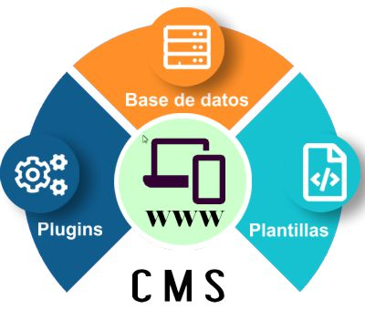

# ¿Que es un Cms?
Un CMS (Content Management System) es una aplicacion que permite crear, editar, organizar y publicar contenidos web sin la necesidad de programar cada pagina o elemento a mano. 
Separa el contenido (ya sea en textos, imagenes y videos) del diseño (plantillas) y de programación.

## ¿Cómo funciona?
Un CMS funciona como una plataforma que permite crear, editar y administrar una página web desde un panel de control, sin tener que modificar directamente el código. 

El administrador añade contenido, como textos, imágenes, productos o noticias, y el CMS guarda esa información en una base de datos. Cuando un usuario visita la web, el CMS obtiene los datos necesarios de la base de datos y los combina con una plantilla para generar y mostrar la página en el navegador.

## Sus tipos y ejemplos
Podemos clasificar los CMS segun el tipo de contendio que gestiona. Alguno de los principales son:

1.  **CMS para paginas web:** El cual sirve para crear y administrar paginas web generales, ya sea con paginas corporativas, portafolios, o sitios informativos

Ejemplos:

- WordPress
- Joomla 
- Drupal
2. **CMS para tiendas online:** Estan diseñados para crear tiendas las cuales puedan gestionar sus productos, precios, stock, pedidos y pagos. 

Ejemplos:

- PrestaShop
- Magento
- Shopify
3. **CMS para blogs:** Estan especialmente pensados para publicar articulos o entradas de forma sencilla y ordenada por categorias, etiquetas o fechas.

Ejemplos:

- WordPress
- Ghost
- Blogger
4. **CMS para wikis y documentacion:** Se centra en crear paginas de informacion que pueden ser modificadas y organizadas facilmente, siendo utiles para manuales, documentacion tecnica o conocimiento interno.

Ejemplo:

- MediaWiki
- DokuWiki
- BookStack
5. **CMS empresariales:** Orientados a empresas y organizaciones que necesitan gestioan gandes cantidades de contenido, usuarios y permisos.

Ejemplos:

- Drupal
- TYPO3
- Umbraco
6. **CMS headless:** Separan la gestion del contenido de la parte visual de la web. El CMS almacena y administra los contenidos, mientras que otra aplicacion los obtiene con API y decide como mostrarlos.

Ejemplos:

- Strapi
- Directus
- Contentful
- Sanity

## Comparacion de generados estaticos

Para realizar la comparación entre Jekyll, Hugo y Astro, se llevó a cabo una investigación centrada en diferentes factores relevantes de cada generador. El objetivo fue recopilar y analizar estos aspectos de forma conjunta para poder establecer una comparación clara entre las tres herramientas.

| **Aspecto que investigar** | **Jekyll** | **Hugo** | **Astro** |
| --- | --- | --- | --- |
| **Tecnología o lenguaje principal** | Programado en Ruby y se instala como una gema | Golang, un lenguaje creado por Google que se compila y se ejecuta muy rápido. | JavaScript y se  instala con npm, el gestor de paquetes de Node.js. |
| **Formato utilizado para el contenido** | Usa por defecto el conversor kramdown | Markdown, con una cabecera de datos llamada front matter al inicio de cada archivo. | Utiliza principalmente Markdown y MDX para gestionar y escribir el contenido, además de archivos .astro para crear las páginas y plantillas de la web. |
| **Necesidad de instalación** | Necesita instalación, porque está hecho en Ruby y no funciona como un programa independiente. | Hugo es muy fácil de instalar: es un único programa (un archivo ejecutable) escrito en Go. | Sí, hay que instalar algo previamente, pero es poco. Necesitas Node.js, una terminal y un editor de código. |
| **Funcionamientobásico** | Jekyll es un generador de sitios estáticos hecho en Ruby. Lee tus archivos de contenido, plantillas y configuración, y genera una carpeta con la web en HTML lista para publicar. | Hugo es un SSG hecho en Go. Lee tus archivos (contenido, plantillas, datos, configuración), los combina y genera el sitio final en HTML. Destaca por su velocidad | Astro toma tus páginas, componentes y contenido, y durante el build los convierte en HTML puro, sin JavaScript en el navegador salvo donde tú lo pidas. |
| **Usos habituales** | Se usa sobre todo para webs con mucho texto y poco cambio constante, donde interesa tener algo simple, rápido y gratuito. | Es un SSG hecho en Go, conocido sobre todo por su velocidad: genera miles de páginas en segundos. | Ideal para webs en las que el contenido es lo más importante y la interactividad es escasa o puntual. |
| **Ventajas**  | - Integrado con GitHub Pages: publicas gratis y sin configurar nada.  - Pensado para blogs: ya incluye entradas, categorías y etiquetas.  - Fácil de aprender: Markdown, plantillas Liquid y poco más.  - Gratuito y de código abierto.| - Muy rápido: genera miles de páginas en segundos, ideal para webs grandes.  - Instalación sencilla: es un único programa, sin depender de Ruby ni Node.js.  - Muchas funciones incluidas: multilenguaje, optimización de imágenes, categorías y feeds RSS sin plugins.| - Muy rápido para el visitante: envía poco o nada de JavaScript al navegador.   - Flexible: permite usar componentes de React, Vue o Svelte solo donde hace falta interactividad.   - Contenido bien organizado: Markdown, MDX y colecciones con esquema que detectan errores en el build. |
| **Inconvenientes** | - Necesita Ruby: la instalación puede dar problemas, sobre todo en Windows.  - Más lento que Hugo: en webs con muchas páginas, el build tarda bastante más.  - Plugins limitados en GitHub Pages: solo admite una lista reducida de plugins.| - Plantillas difíciles: las plantillas de Go tienen una sintaxis rara y una curva de aprendizaje mayor que Liquid (Jekyll) o los archivos .astro.  - Errores poco claros: cuando algo falla en una plantilla, los mensajes pueden ser difíciles de entender.  - Menos flexible para interactividad: no está pensado para integrar componentes de React o Vue como Astro.| - Ecosistema más joven: tiene menos temas, plugins y tutoriales que Jekyll, y su comunidad es más pequeña.  - Cambios frecuentes entre versiones: las actualizaciones pueden obligar a modificar el proyecto y a subir la versión mínima de Node.js.  - Más lento que Hugo en webs muy grandes: al estar hecho en JavaScript, el build tarda más con miles de páginas. |
| **Posibilidad de publicarlo en GitHub Pages** | Sí, es totalmente posible. Es la combinación más natural, porque GitHub Pages admite Jekyll de forma nativa | Sí, es posible y gratuito, pero con una diferencia respecto a Jekyll: GitHub Pages solo construye Jekyll de forma nativa, así que con Hugo el build se hace con GitHub Actions. | Sí, es posible y muy habitual. Astro genera archivos estáticos, así que se puede publicar gratis en GitHub Pages.Sí, es posible y muy habitual. Astro genera archivos estáticos, así que se puede publicar gratis en GitHub Pages. |

**Fuente:** W3Techs, [Usage statistics and market share of content management systems](https://w3techs.com/technologies/overview/content_management). Datos a 26 de octubre de 2026.

## Los CMS más utilizados

| Posición | CMS | % de todos los sitios web | % de cuota entre los sitios con CMS |
| --- | --- | --- | --- |
| 1 | **WordPress** | 39,6 % | 58,3 % |
| 2 | **Shopify** | 5,3 % | 7,9 % |
| 3 | **Wix** | 4,2 % | 6,2 % |
| 4 | **Squarespace** | 2,4 % | 3,6 % |
| 5 | **Joomla** | 1,1 % | 1,6 % |

### Por finalidad

| Finalidad | Descripción | Ejemplos |
| --- | --- | --- |
| **Páginas web generales** | Webs corporativas, portafolios o sitios informativos | WordPress, Joomla, Wix, Squarespace |
| **Tiendas online** | Gestión de productos, precios, stock, pedidos y pagos | PrestaShop, Magento, Shopify |
| **Blogs** | Publicación de entradas ordenadas por categorías, etiquetas o fechas | WordPress, Ghost, Blogger |
| **Wikis y documentación** | Páginas editables y organizadas, para manuales o conocimiento interno | MediaWiki, DokuWiki, BookStack |
| **Portales corporativos / empresariales** | Grandes volúmenes de contenido, usuarios y permisos | Drupal, TYPO3, Umbraco |

### Por arquitectura

| Arquitectura | Cómo funciona | Ejemplos |
| --- | --- | --- |
| **Tradicional (monolítico)** | La gestión del contenido y la presentación van juntas en la misma aplicación. El CMS genera las páginas con sus plantillas. | WordPress, Joomla, Drupal, PrestaShop |
| **Desacoplado** | Back-end y front-end están separados, pero el CMS conserva su propia capa de presentación y además ofrece una API. | Drupal o WordPress usados con un front-end propio y una API |
| **Headless** | No tiene capa de presentación. Solo almacena el contenido y lo entrega por API a cualquier aplicación (web, móvil, etc.). | Strapi, Directus, Contentful, Sanity |

## Videos de referencia

Si quieres profundizar un poco más en el tema, aquí puedes ver un vídeo corto (menos de 5 minutos) que explica qué es un CMS y cómo funciona:

[Qué es un CMS y para qué sirve (Explicado en 2 minutos)](https://www.youtube.com/watch?v=sSh5AAmItN0)

Si quieres conocer más sobre los SSG (Static Site Generators) y cómo funcionan, puedes consultar la siguiente información: [enlace](ssg.md).

